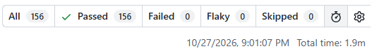

# SauceDemo UI Automation (Playwright + JavaScript)

Automated regression suite for https://www.saucedemo.com, built from a 53-case manual test cycle (45 passed, 8 failed, 8 defects logged).

- **Tool:** Playwright + JavaScript (Node.js, CommonJS)
- **Pattern:** Page Object Model, custom fixtures, data-test locators
- **Coverage:** 51 of 53 manual cases have dedicated tests (52 tests per browser, because TC-049 is split in two). TC-046 (cross-browser) is covered by the three browser projects, and TC-048 (visual check) stays manual.
- **Browsers:** Chromium (Chrome), Firefox, Edge, 156 test executions per run
- **CI:** GitHub Actions on every push and pull request
- **Known defects:** 7 of the 8 bugs from the manual cycle are automated as expected-failure tests(BUG-003 stays manual)

## Quick start

Requirements: Node.js 20 or newer.

```bash
npm install
npx playwright install chromium firefox msedge
npx playwright test
npm run report
```

Useful commands:

| Command | What it does |
|---------|--------------|
| `npm test` | Run all tests in all browsers |
| `npm run test:smoke` | Only `@smoke` tests (TC-001, 021, 030, 041) |
| `npm run test:chromium` | One browser only |
| `npm run test:headed` | Watch the browser while testing |
| `npm run test:ui` | Playwright UI mode with time-travel debugging |
| `npm run report` | Open the HTML report |

## Project structure

```
.
├── playwright.config.js      # browsers, base URL, reporters, data-test attribute
├── pages/                    # Page Objects: Login, Inventory, Cart, Checkout
├── fixtures/fixtures.js      # injects pages and loginAs(user) into tests
├── test-data/data.js         # users, products, prices, expected messages
├── utils/known-defect.js     # marks a test as a known defect (BUG-00X)
├── tests/
│   ├── login.spec.js         # TC-001 to 011
│   ├── session.spec.js       # TC-012 to 014
│   ├── inventory.spec.js     # TC-015 to 020
│   ├── cart.spec.js          # TC-021 to 029
│   ├── checkout.spec.js      # TC-030 to 042
│   ├── product-and-ui.spec.js# TC-043 to 045, 047
│   └── user-profiles.spec.js # TC-049 to 053 (known defects)
├── docs/
│   ├── automation-approach.md
│   └── traceability.md       # manual TC -> automated test
└── .github/workflows/playwright.yml
```

## How known defects work

Tests for the special user profiles describe the **correct** behavior and are wrapped with `knownDefect('BUG-004', '...')`. While the bug exists the test is reported as **passed** (expected failure); when the bug is fixed it turns **red** and tells you to remove the marker. Details: [docs/automation-approach.md](./docs/automation-approach.md).

| Bug | Test | Behavior |
|-----|------|----------|
| BUG-001 | TC-029 | Checkout opens with an empty cart |
| BUG-002 | TC-035 | Checkout accepts 256+ and special characters |
| BUG-004 | TC-049a, 049b | problem_user: identical images, Add buttons fail |
| BUG-005 | TC-050 | problem_user: sorting does nothing |
| BUG-006 | TC-051 | problem_user: Last Name goes into First Name |
| BUG-007 | TC-052 | performance_glitch_user: inventory loads in about 5 s |
| BUG-008 | TC-053 | error_user: Finish button cannot be clicked |

BUG-003 (`visual_user` layout and prices) stays a manual check.

## Documentation
- [Automation approach](./docs/automation-approach.md)
- [Manual to automated traceability](./docs/traceability.md)

## Related project
Manual testing repository (test plan, 53 test cases, traceability matrix, bug reports): https://github.com/anupdhojpantha/saucedemo-manual-testing.git

## Results (2026-10-27)

| Metric | Result |
|--------|--------|
| Tests per browser | 52 |
| Browsers | Chromium, Firefox, Edge |
| Total executions | 156 |
| Passed | 156 |
| Failed | 0 |
| Flaky | 0 |
| Total run time | 1.9 minutes |

8 of the passing tests are known-defect tests (BUG-001, 002, 004 to 008). They pass because the bug still exists on the site and will turn red when it is fixed.


